<div align="center">

# EventPass

**Event registration with signed, single-use QR passes, delivered through a complete DevOps pipeline.**


</div>

---

## Table of contents

1. [Overview](#1-overview)
2. [DevOps concepts used and why this project needs them](#2-devops-concepts-used-and-why-this-project-needs-them)
3. [High-Level Design (HLD)](#3-high-level-design-hld)
4. [Flowcharts](#4-flowcharts)
5. [Low-Level Design (LLD)](#5-low-level-design-lld)
6. [Tech stack](#6-tech-stack)
7. [Project structure](#7-project-structure)
8. [Getting started](#8-getting-started)
9. [API reference](#9-api-reference)
10. [Configuration](#10-configuration)
11. [Testing & quality gates](#11-testing--quality-gates)
12. [Git workflow](#12-git-workflow)
13. [CI/CD pipeline](#13-cicd-pipeline)
14. [Kubernetes deployment](#14-kubernetes-deployment)
15. [Infrastructure as Code (Terraform)](#15-infrastructure-as-code-terraform)
16. [Monitoring & logging](#16-monitoring--logging)
17. [Security](#17-security)
18. [10-minute demo script](#18-10-minute-demo-script)
19. [Troubleshooting](#19-troubleshooting)

---

## 1. Overview

EventPass is a deliberately small MERN application. Its purpose is to **demonstrate DevOps practices end to end**:
version control, containers, automated testing, CI/CD, security scanning, orchestration, infrastructure as code
and observability.

The application has exactly three features:

| # | Feature | What happens |
|---|---|---|
| 1 | **Create & list events** | Anyone creates an event (title, date, venue, capacity) and sees all events with live seat counts. |
| 2 | **Register** | A user enters a name and email and receives a **QR pass** that contains an HMAC-signed token. |
| 3 | **Verify** | The token is checked: the **first** check-in is accepted (200). A reused pass is rejected (409), and a tampered pass is rejected (401). |

There is intentionally **no login, admin role, email or export**. The small scope keeps the focus on how the
software is built, shipped, run and observed.

---

## 2. DevOps concepts used and why this project needs them

| # | DevOps concept | Where it lives | Why EventPass needs it |
|---|---|---|---|
| 1 | **Version control & branching strategy** | Git, `main` / `dev` / `feature/*` | Several changes (API, UI, infra) happen in parallel. Branches isolate them, and only reviewed code reaches the deployable `main` branch. |
| 2 | **Conventional Commits** | Commit messages | A readable history (`feat:`, `fix:`, `ci:`) makes it clear what changed in each deployment and helps with rollbacks. |
| 3 | **Containerization** | `server/Dockerfile`, `client/Dockerfile` | The same image runs on a laptop, in CI, on Kubernetes and on EC2, so "works on my machine" problems go away. |
| 4 | **Multi-stage builds & layer caching** | Both Dockerfiles | The client is compiled in a Node stage but shipped as static files on nginx (small image). Copying `package*.json` before the source caches the dependency layer, so rebuilds are fast. |
| 5 | **Least privilege / hardened images** | `USER node`, `nginx-unprivileged`, npm removed from the runtime image, K8s `securityContext` | A compromised container should not have root or extra tools. Fewer packages also means fewer CVEs for Trivy to report. |
| 6 | **Health checks** | `GET /health`, Docker `HEALTHCHECK`, Compose `service_healthy`, K8s probes | `/health` returns 503 when MongoDB is down. Orchestrators use it to start services in order, keep traffic away from unready pods and restart broken ones. |
| 7 | **Multi-container orchestration** | `docker-compose.yml` | One command starts 5 services (Mongo, API, web, Prometheus, Grafana) with a private network, a named volume and a startup order. |
| 8 | **Twelve-factor configuration** | `.env.example`, `env_file`, ConfigMap | The same build is promoted across environments. Only environment variables change (DB URL, public URL, log level). |
| 9 | **Secrets management** | `.env` (git-ignored), K8s `Secret`, GitHub Secrets, Terraform `sensitive` variables | `QR_SIGNING_SECRET` signs every pass. If it leaked, anyone could forge passes, so it never appears in code or git. |
| 10 | **Continuous Integration** | `.github/workflows/ci-cd.yml` (lint, test, security jobs) | Every push and PR is checked automatically, so broken or insecure code is caught before merge. |
| 11 | **Automated testing & coverage gate** | Jest + Supertest + mongodb-memory-server, 70% threshold | Proves the business rules: no overbooking, a duplicate email returns 409, a pass works once, a tampered token returns 401. The build fails if coverage drops below 70%. |
| 12 | **Static analysis** | ESLint + Prettier (`--check` in CI) | Consistent, bug-resistant code. Style is enforced by tools, not by review comments. |
| 13 | **DevSecOps (shift-left security)** | `npm audit`, Trivy filesystem scan, Trivy image scan | Vulnerable dependencies or base images are found **before** they are pushed or deployed. |
| 14 | **Artifact registry & immutable tags** | Docker Hub `latest` + `sha-<short>` | Each commit produces a traceable image. Deploying or rolling back means picking a tag. |
| 15 | **Continuous Delivery / Deployment** | `build-push` + `deploy` jobs (SSH → `docker compose pull && up -d`) | Merging to `main` ships to EC2 with no manual steps. The job is skipped safely when no server is configured. |
| 16 | **Pipeline caching** | Buildx GHA cache, npm cache, MongoDB binary cache | Keeps feedback fast (minutes, not tens of minutes), which encourages small, frequent commits. |
| 17 | **Container orchestration (Kubernetes)** | `k8s/*.yaml` | Covers self-healing, scaling and zero-downtime releases (below), which Compose alone cannot provide. |
| 18 | **Rolling updates & rollback** | `RollingUpdate` (maxSurge 1, maxUnavailable 0), `kubectl rollout undo` | New versions replace old pods one at a time with no downtime. A bad release is reverted with one command. |
| 19 | **Auto-scaling** | `HorizontalPodAutoscaler` (CPU 70%, 2–5 pods) | Check-in rushes at an event entrance are bursty. Pods scale up under load and back down afterwards. |
| 20 | **Stateful workloads** | MongoDB `StatefulSet` + PVC | The database keeps its data and a stable identity across pod restarts. |
| 21 | **Ingress / reverse proxy** | nginx (`nginx.conf`), K8s Ingress | A single entry point serves the SPA and routes `/api`, so the browser never deals with CORS or internal ports. |
| 22 | **Infrastructure as Code** | `terraform/` | The EC2 server, firewall, IP and bootstrap are versioned, reviewable and reproducible. `terraform destroy` removes everything, so you stop paying for it. |
| 23 | **Configuration management / bootstrap** | `terraform/user_data.sh` | A fresh VM installs Docker, writes config and starts the stack with no manual SSH steps. |
| 24 | **Observability: metrics** | `prom-client` → Prometheus → Grafana | Request rate, p95 latency and business metrics (registrations, check-ins, failures by reason) show whether the system **and** the event are healthy. |
| 25 | **Observability: structured logging** | pino JSON logs to stdout | Machine-readable logs, collected by `docker compose logs` / `kubectl logs` without log files inside containers. |
| 26 | **Graceful shutdown** | `SIGTERM` handler in `server.js` | During rolling updates and scale-downs, in-flight check-ins finish before the pod exits. |
| 27 | **Concurrency safety** | Atomic `findOneAndUpdate` for seats and check-ins | Two replicas can serve the same event at once. Atomic updates in the database (not in app memory) keep that correct. |

---

## 3. High-Level Design (HLD)

### 3.1 System context

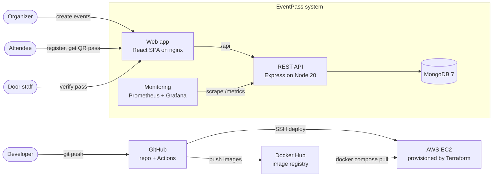

### 3.2 Runtime architecture

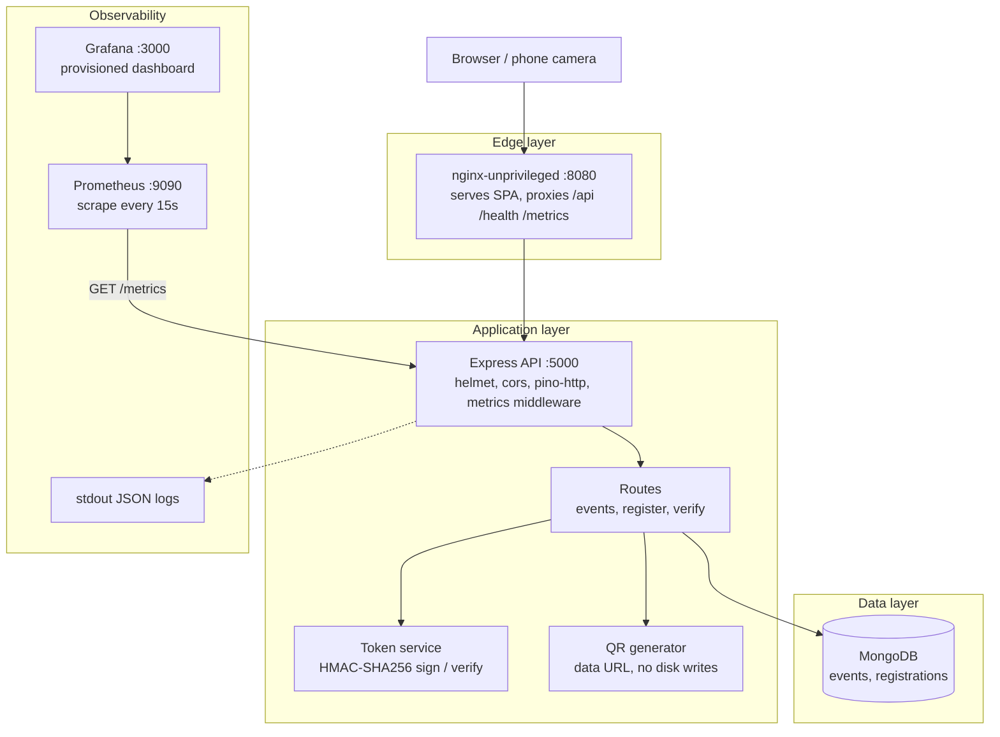

### 3.3 Deployment views

The same container images run in three environments.

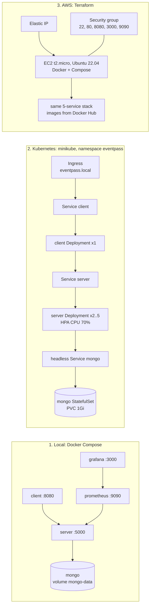

### 3.4 Delivery pipeline (HLD)

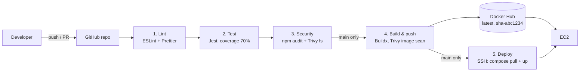

---

## 4. Flowcharts

### 4.1 End-to-end user journey

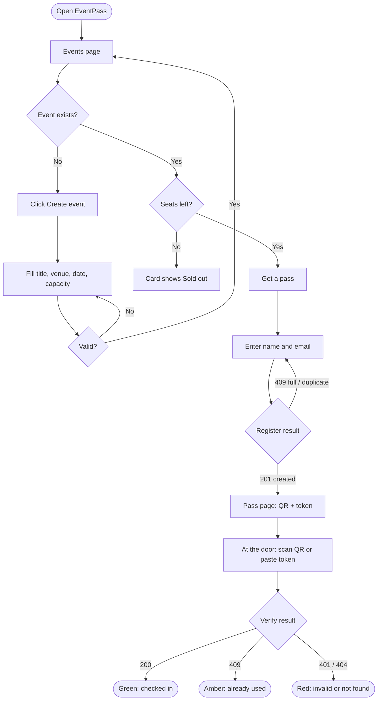

### 4.2 Registration logic (server)

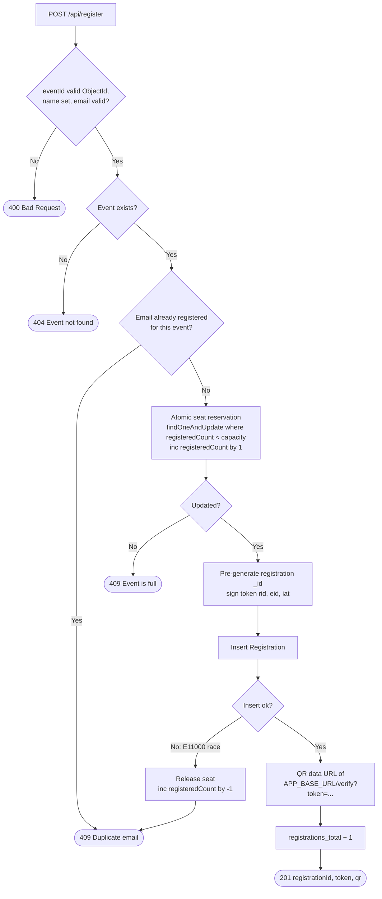

### 4.3 Verification logic (server)

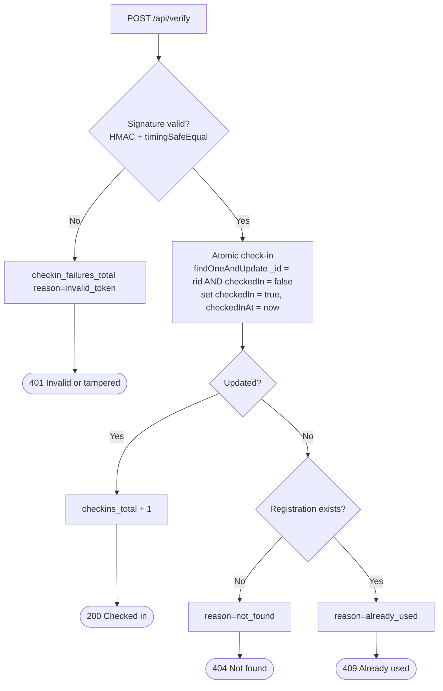

### 4.4 Container startup order (Docker Compose)

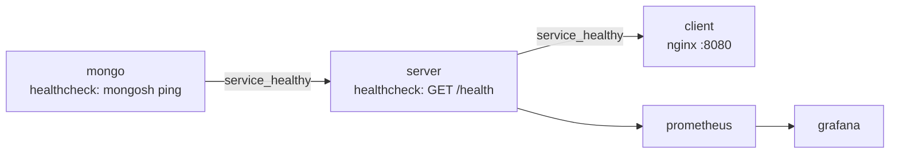

---

## 5. Low-Level Design (LLD)

### 5.1 Backend module design

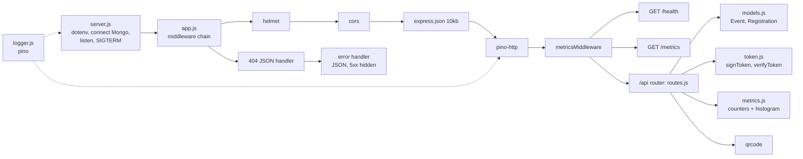

| Module | Responsibility |
|---|---|
| `server.js` | Process entrypoint: loads env, fails fast without `QR_SIGNING_SECRET`, connects to MongoDB, starts HTTP, graceful shutdown on `SIGTERM`/`SIGINT`. |
| `app.js` | Builds the Express app (exported separately so tests can run it without a network port). Holds the security headers, logging, metrics, ops routes and JSON error handling. |
| `routes.js` | Business logic for `/api/events`, `/api/register`, `/api/verify`. |
| `models.js` | Mongoose schemas and the unique `{event, email}` index. |
| `token.js` | Pass token signing and constant-time verification. |
| `metrics.js` | Prometheus registry, HTTP metrics middleware and business counters. |
| `logger.js` | Shared pino JSON logger. |

### 5.2 Data model

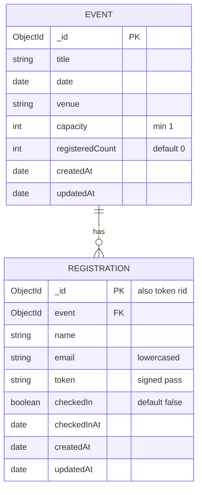

**Indexes and invariants**
- `Registration {event: 1, email: 1}` is **unique**, so one pass per email per event (the database enforces it even under races).
- `0 ≤ Event.registeredCount ≤ Event.capacity` is enforced by the conditional atomic `$inc`.
- `checkedIn` only ever moves from `false` to `true`, through a conditional atomic update.

### 5.3 Registration lifecycle

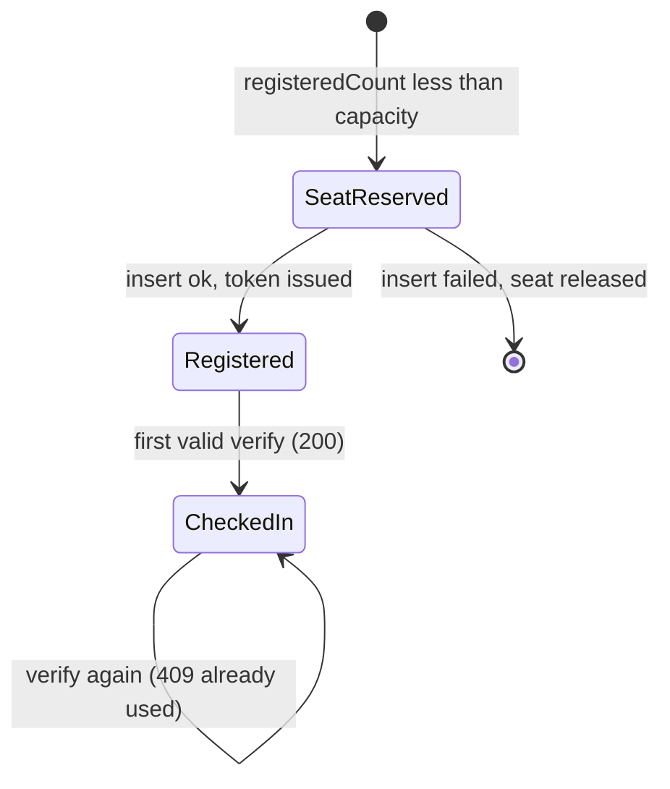

### 5.4 Pass token format

```
base64url( {"rid":"<registrationId>","eid":"<eventId>","iat":<ms>} ) . base64url( HMAC-SHA256(part1, QR_SIGNING_SECRET) )
└──────────────────────────── payload ─────────────────────────────┘   └──────────────────── signature ────────────────────┘
```

- **Integrity**: changing any byte of the payload or signature fails verification, so the server returns 401.
- **Constant-time comparison**: `crypto.timingSafeEqual` on the exact base64url strings resists timing attacks and alternate encodings.
- **Stateless check, stateful use**: the signature is verified without a DB lookup. Single use is enforced by the atomic `checkedIn` update.
- The QR code encodes `APP_BASE_URL/verify?token=…`, so scanning it with a phone camera opens the Verify page, which checks the pass in automatically.

### 5.5 Sequence: register for an event

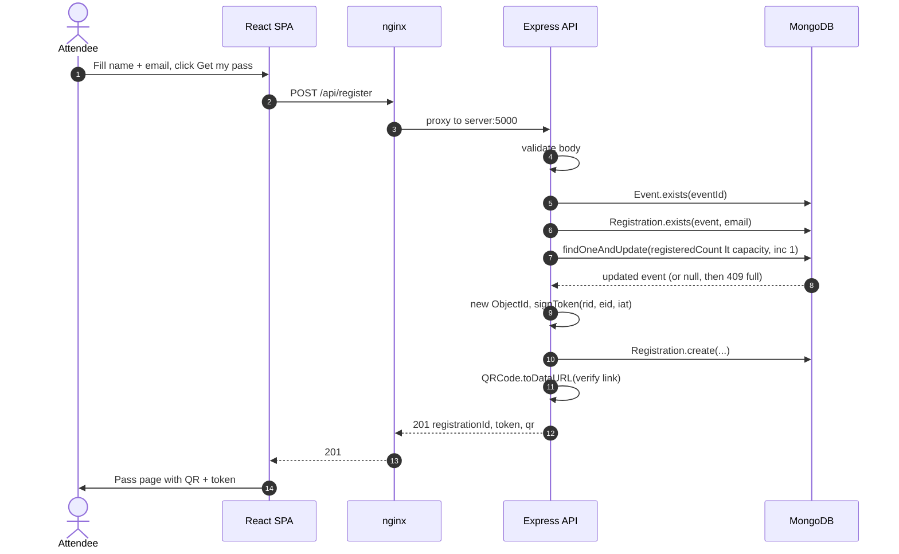

### 5.6 Sequence: verify a pass at the door

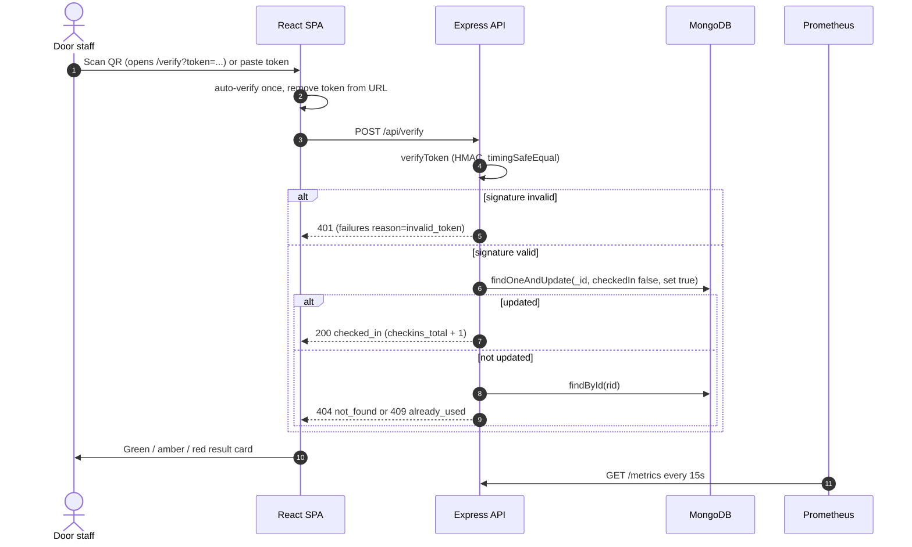

### 5.7 Frontend component design

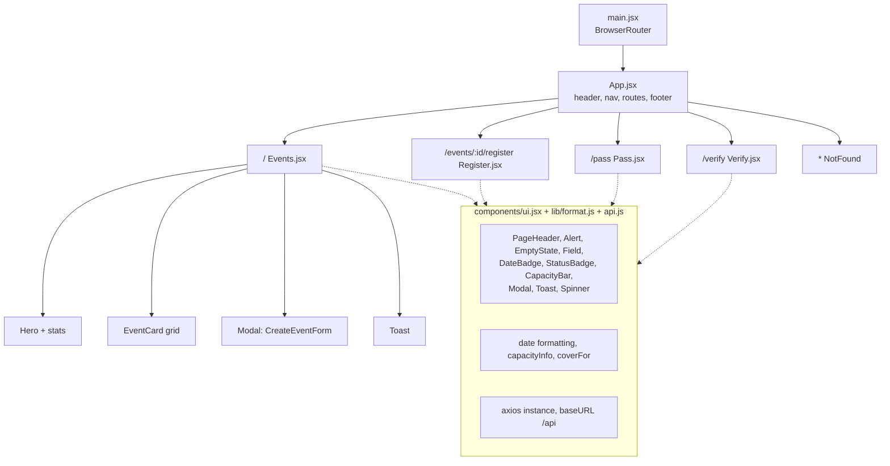

- **Routing state**: Register passes `{token, qr, name, event}` to Pass through router state, so nothing sensitive goes into `localStorage`.
- **Verify** runs `?token=` only once (a `useRef` guard against React StrictMode's double effect), then strips it from the URL so a refresh can't re-submit it.
- **Styling**: Tailwind CSS v3, a dark theme and lucide-react icons. The layout is responsive from 360 px phones to wide desktops (modal becomes a bottom sheet on phones, the grid goes 1 → 2 → 3 columns).

### 5.8 Kubernetes object design

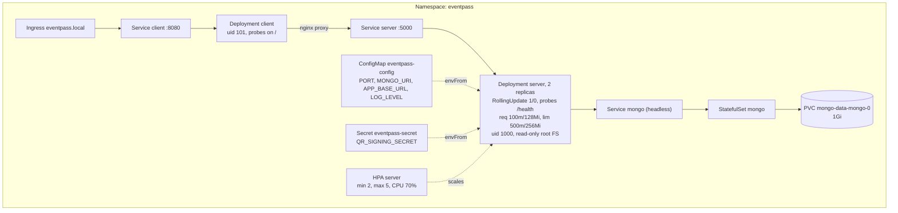

### 5.9 CI/CD job design

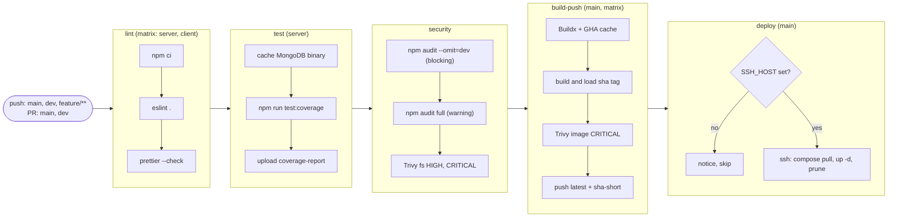

### 5.10 Metrics design

| Metric | Type | Labels | Answers the question |
|---|---|---|---|
| `http_requests_total` | Counter | `method`, `route`, `status` | How much traffic is there, and how many errors? |
| `http_request_duration_seconds` | Histogram | `method`, `route`, `status` | How fast is the API (p95)? |
| `registrations_total` | Counter | – | How many passes have been issued? |
| `checkins_total` | Counter | – | How many people have entered? |
| `checkin_failures_total` | Counter | `reason` = `invalid_token`, `not_found`, `already_used` | Is someone reusing or forging passes? |
| Node defaults | various | – | CPU, memory, event-loop lag, GC |

The `route` label uses the matched route pattern (for example `/api/events`), not the raw URL, to keep the number of label values low.

---

## 6. Tech stack

| Layer | Technology |
|---|---|
| Frontend | React 18, Vite 6, Tailwind CSS 3, React Router 7, Axios, lucide-react |
| Backend | Node.js 20, Express 4 (ES modules), Mongoose 8, `qrcode`, Node `crypto` |
| Database | MongoDB 7 |
| Logging / metrics | pino, pino-http, prom-client |
| Testing | Jest 29, Supertest, mongodb-memory-server |
| Code quality | ESLint 9 (flat config), Prettier 3 |
| Containers | Docker (multi-stage), Docker Compose v2, nginx-unprivileged |
| CI/CD | GitHub Actions, Docker Buildx, Docker Hub, Trivy |
| Orchestration | Kubernetes (minikube): Deployment, StatefulSet, Service, Ingress, HPA, ConfigMap, Secret |
| IaC / cloud | Terraform (AWS provider 5.x), AWS EC2, Elastic IP, Security Group |
| Monitoring | Prometheus 2.53, Grafana 11 (provisioned datasource and dashboard) |

---

## 7. Project structure

```
eventpass/
├── client/                         React SPA
│   ├── src/
│   │   ├── api.js                  axios instance (baseURL /api)
│   │   ├── App.jsx                 layout, navigation, routes
│   │   ├── main.jsx                entry, BrowserRouter
│   │   ├── index.css               Tailwind + component classes
│   │   ├── components/ui.jsx       shared UI (Modal, Alert, badges, …)
│   │   ├── lib/format.js           date + capacity helpers
│   │   └── pages/                  Events, Register, Pass, Verify
│   ├── nginx.conf                  SPA fallback + /api proxy
│   └── Dockerfile                  node build → nginx-unprivileged
├── server/                         Express API
│   ├── src/                        app, server, routes, models, token, metrics, logger
│   ├── tests/                      token.test.js, api.test.js, setup.js
│   └── Dockerfile                  multi-stage, non-root, HEALTHCHECK
├── monitoring/
│   ├── prometheus.yml              scrape config
│   └── grafana/                    provisioned datasource + dashboard
├── k8s/                            namespace, configmap, secret example, mongo, server, client, ingress, hpa
├── terraform/                      main.tf, variables.tf, outputs.tf, user_data.sh, tfvars example
├── .github/workflows/ci-cd.yml     CI/CD pipeline
├── docker-compose.yml              5-service local stack
├── .env.example                    every environment variable
└── plan.md                         build log and decisions
```

---

## 8. Getting started

### 8.1 Prerequisites

| Tool | Version | Needed for |
|---|---|---|
| Node.js | 20+ | local development, tests |
| MongoDB | 7 | local development without Docker |
| Docker Desktop | recent, with Compose v2 | Docker Compose, image builds |
| minikube + kubectl | recent | Kubernetes section |
| Terraform + AWS CLI credentials | ≥ 1.5 | AWS section |

### 8.2 Run locally (without Docker)

```bash
# Terminal 1: API (needs MongoDB on localhost:27017)
cd server
cp ../.env.example .env      # set QR_SIGNING_SECRET, APP_BASE_URL=http://localhost:5173
npm ci
npm run dev                  # http://localhost:5000  (node --watch)

# Terminal 2: web app
cd client
npm ci
npm run dev                  # http://localhost:5173  (Vite proxies /api → :5000)
```

Generate a strong secret:

```bash
node -e "console.log(require('crypto').randomBytes(32).toString('hex'))"
```

### 8.3 Run with Docker Compose

```bash
cp .env.example .env           # optional: a fresh clone runs with dev defaults
docker compose up --build -d   # build and start all 5 services
docker compose ps              # mongo, server, client should be "healthy"
docker compose logs -f server  # JSON logs
docker compose down -v         # stop and remove volumes
```

| Service | URL | Notes |
|---|---|---|
| Web app | http://localhost:8080 | SPA; nginx proxies `/api`, `/health`, `/metrics` |
| Health | http://localhost:8080/health | `{"status":"ok","db":"up"}` |
| Metrics | http://localhost:8080/metrics | Prometheus text format |
| Prometheus | http://localhost:9090 | Status → Targets shows `eventpass-server` UP |
| Grafana | http://localhost:3000 | **admin / admin**, dashboard *EventPass* |

> Without a `.env`, Compose uses the dev-only secret `dev-only-change-me`. Always set a real `QR_SIGNING_SECRET` outside local development.

---

## 9. API reference

All application routes are under `/api`, and all responses are JSON.

| Method | Path | Request body | Responses |
|---|---|---|---|
| `GET` | `/api/events` | – | `200` list of `{id, title, date, venue, capacity, registeredCount}`, sorted by date |
| `POST` | `/api/events` | `{title, date, venue, capacity}` | `201` event · `400` invalid input |
| `POST` | `/api/register` | `{eventId, name, email}` | `201 {registrationId, token, qr}` · `400` invalid · `404` unknown event · `409` full · `409` duplicate email |
| `POST` | `/api/verify` | `{token}` | `200` checked in · `401` invalid/tampered · `404` not found · `409` already used |
| `GET` | `/health` | – | `200 {status:"ok", db:"up"}` · `503` when MongoDB is down |
| `GET` | `/metrics` | – | Prometheus exposition format |

Example:

```bash
curl -s -X POST localhost:8080/api/events -H 'Content-Type: application/json' \
  -d '{"title":"DevOps Meetup","date":"2030-01-15T18:00:00Z","venue":"Hall A","capacity":50}'
```

---

## 10. Configuration

| Variable | Used by | Default | Description |
|---|---|---|---|
| `PORT` | server | `5000` | API port |
| `MONGO_URI` | server | `mongodb://localhost:27017/eventpass` | Compose and K8s use `mongodb://mongo:27017/eventpass` |
| `QR_SIGNING_SECRET` | server | – (**required**) | HMAC key; the server refuses to start without it |
| `APP_BASE_URL` | server | `http://localhost:8080` | Public web URL encoded into each QR code |
| `LOG_LEVEL` | server | `info` | `debug`, `info`, `warn`, `error`, `silent` |
| `DOCKER_USERNAME` | compose | `eventpass` | Image namespace `<user>/eventpass-{server,client}` |
| `IMAGE_TAG` | compose | `latest` | `latest` or `sha-<short>` |
| `GF_SECURITY_ADMIN_USER` / `_PASSWORD` | grafana | `admin` / `admin` | Grafana login |

Every variable is listed in [`.env.example`](.env.example). Copy it to `.env`; never commit `.env`.

---

## 11. Testing & quality gates

```bash
cd server
npm ci
npm test                    # Jest: token + API tests against in-memory MongoDB
npm run test:coverage       # fails below 70% (branches, functions, lines, statements)
npm run lint && npm run format:check

cd ../client
npm ci
npm run lint && npm run format:check && npm run build
```

| Test file | Covers |
|---|---|
| `tests/token.test.js` | Sign/verify round trip; tampered payload; tampered signature; wrong secret; malformed tokens; valid signature with a bad payload; missing secret |
| `tests/api.test.js` | Create/list events; validation (400); register (token + QR); full event (409); duplicate email, case-insensitive (409); unknown event (404); verify (200); reuse (409); tampered/garbage token (401); unknown registration (404); `/health` 200 and 503; `/metrics`; unknown route (404); malformed JSON (400) |

The first run downloads a MongoDB 7.0.14 binary (~100 MB) for mongodb-memory-server.

---

## 12. Git workflow

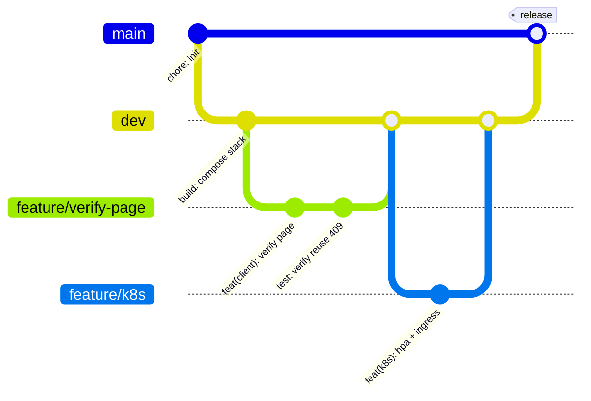

| Branch | Purpose | CI behaviour |
|---|---|---|
| `main` | Always deployable, protected, PR only | lint → test → security → **build-push → deploy** |
| `dev` | Integration branch | lint → test → security |
| `feature/<name>` | One change per branch, cut from `dev` | lint → test → security |

**Conventional Commits**

```
feat(server): add atomic seat reservation on register
fix(client): stop double check-in under React StrictMode
test(server): cover tampered token returns 401
ci: add Trivy image scan before push
build(docker): run server as non-root node user
docs(readme): add HLD and LLD diagrams
chore(deps): bump react-router-dom to 7.18.4
```

> This folder must be its **own** Git repository for GitHub Actions to run:
> `git init -b main && git add . && git commit -m "chore: initial commit"`, then push to GitHub.

---

## 13. CI/CD pipeline

Workflow: [`.github/workflows/ci-cd.yml`](.github/workflows/ci-cd.yml). Each job `needs` the previous one, so one failure stops the chain. The job design diagram is in [5.9](#59-cicd-job-design).

| # | Job | Steps | Runs on |
|---|---|---|---|
| 1 | **lint** | `npm ci`, `eslint .`, `prettier --check` (server and client matrix) | every push and PR |
| 2 | **test** | Jest with coverage (70% gate), `coverage-report` artifact | every push and PR |
| 3 | **security** | `npm audit --omit=dev --audit-level=high` (blocking), full audit (warning), Trivy filesystem scan | every push and PR |
| 4 | **build-push** | Buildx + GHA cache → build → **Trivy image scan** → push `latest` and `sha-<short>` | push to `main` |
| 5 | **deploy** | SSH to EC2 → `docker compose pull && docker compose up -d`; **skipped cleanly** when `SSH_HOST` is unset | push to `main` |

**Why the audit gate uses `--omit=dev`:** the only HIGH advisories are in dev-only build and test tooling
(`braces`, pulled in by Jest 29 and Tailwind v3), and that advisory covers every version, so no upgrade fixes it. None of that code ships in the images.
The full audit still runs and reports as a warning.

**GitHub secrets** (Settings → Secrets and variables → Actions)

| Secret | Required | Value |
|---|---|---|
| `DOCKER_USERNAME` | for build-push | Docker Hub username |
| `DOCKER_PASSWORD` | for build-push | Docker Hub access token |
| `SSH_HOST` | optional | EC2 public IP. Leave unset to skip deploy |
| `SSH_USER` | optional | defaults to `ubuntu` |
| `SSH_KEY` | with `SSH_HOST` | private key matching Terraform's `public_key_path` |

---

## 14. Kubernetes deployment

| Manifest | Contents |
|---|---|
| `namespace.yaml` | Namespace `eventpass` |
| `configmap.yaml` | Non-secret configuration |
| `secret.example.yaml` | Commented template only; the real secret is created with `kubectl` |
| `mongo.yaml` | StatefulSet + PVC (volumeClaimTemplates) + headless Service |
| `server.yaml` | Deployment (2 replicas, RollingUpdate, `/health` probes, requests/limits) + Service |
| `client.yaml` | Deployment + Service |
| `ingress.yaml` | Host `eventpass.local` → client |
| `hpa.yaml` | HorizontalPodAutoscaler, CPU 70%, 2–5 pods |

```bash
# 1. cluster and add-ons
minikube start --cpus=4 --memory=6g
minikube addons enable ingress
minikube addons enable metrics-server

# 2. build images and load them into minikube
docker build -t eventpass-server:v1 -t eventpass-server:latest ./server
docker build -t eventpass-client:latest ./client
minikube image load eventpass-server:latest
minikube image load eventpass-server:v1
minikube image load eventpass-client:latest

# 3. namespace → secret → everything else
kubectl apply -f k8s/namespace.yaml
kubectl -n eventpass create secret generic eventpass-secret \
  --from-literal=QR_SIGNING_SECRET="$(openssl rand -hex 32)"
kubectl apply -f k8s/

# 4. watch it come up
kubectl -n eventpass rollout status deployment/server
kubectl -n eventpass get pods,svc,ingress,hpa
kubectl -n eventpass logs -l app=server -f
```

**Open the app**

- **Windows / macOS (Docker driver):**
  1. Run `minikube tunnel` in its own terminal.
  2. Add `127.0.0.1 eventpass.local` to your hosts file (`C:\Windows\System32\drivers\etc\hosts` on Windows).
- **Linux:** add `$(minikube ip) eventpass.local` to `/etc/hosts`.
- **Shortcut without Ingress:** `kubectl -n eventpass port-forward svc/client 8080:8080`

**Rollout, rollback, scaling**

```bash
docker build -t eventpass-server:v2 ./server && minikube image load eventpass-server:v2
kubectl -n eventpass set image deployment/server server=eventpass-server:v2
kubectl -n eventpass rollout status deployment/server
kubectl -n eventpass rollout history deployment/server
kubectl -n eventpass rollout undo deployment/server          # roll back

kubectl -n eventpass scale deployment/server --replicas=3    # the HPA may later adjust this back
kubectl -n eventpass get hpa server

kubectl delete namespace eventpass                           # clean up
```

---

## 15. Infrastructure as Code (Terraform)

Terraform creates:
- one **t2.micro** Ubuntu 22.04 instance (free-tier eligible), with a 20 GiB encrypted gp3 disk and IMDSv2 only;
- a **security group** opening 22 (your IP), 80, 8080, 3000 and 9090;
- an **Elastic IP**.

On first boot, `user_data.sh`:
1. adds 2 GiB of swap;
2. installs Docker and the Compose plugin;
3. writes `/opt/eventpass/.env`, a pull-only `docker-compose.yml` and the monitoring config;
4. starts the stack from Docker Hub, retrying until the images exist.

```bash
cd terraform
cp terraform.tfvars.example terraform.tfvars   # fill in your values
terraform init
terraform fmt -check && terraform validate
terraform plan
terraform apply
terraform output        # public_ip, app_url, grafana_url, prometheus_url, ssh_command
```

1. Push to `main` first so the images exist on Docker Hub.
2. After `apply`, allow 3–5 minutes for bootstrap. The log is at `/var/log/eventpass-bootstrap.log`.
3. For automatic deploys, set `SSH_HOST` to `public_ip` and `SSH_KEY` to the matching private key.
   GitHub runners use changing IPs, so `ssh_cidr` must allow them; use key-only auth.

> ⚠️ **Run `terraform destroy` when you are finished.** Instance hours, disks and an Elastic IP cost money outside the free tier, and an idle Elastic IP is billed.
>
> ⚠️ **Never commit `terraform.tfvars` or `*.tfstate`.** They contain secrets. `.gitignore` already excludes them.

---

## 16. Monitoring & logging

- **Logs**: JSON lines on stdout via pino / pino-http. `/health` and `/metrics` requests are skipped to reduce noise.
  - `docker compose logs -f server`
  - `kubectl -n eventpass logs -l app=server -f`
- **Metrics**: `GET /metrics`, scraped by Prometheus every 15 s. See the [metrics design](#510-metrics-design).
- **Dashboard**: Grafana auto-provisions the datasource and the **EventPass** dashboard, with panels for request rate by route, p95 latency, total registrations, check-ins and check-in failures by reason.

Useful PromQL:

```promql
# request rate per route
sum by (route) (rate(http_requests_total[1m]))

# p95 latency
histogram_quantile(0.95, sum by (le) (rate(http_request_duration_seconds_bucket[5m])))

# 5xx error ratio
sum(rate(http_requests_total{status=~"5.."}[5m])) / sum(rate(http_requests_total[5m]))

# business metrics
sum(registrations_total)
sum(checkins_total)
sum by (reason) (checkin_failures_total)
```

---

## 17. Security

| Area | Control |
|---|---|
| Pass integrity | HMAC-SHA256 signature, constant-time comparison, single use enforced atomically in the DB |
| Secrets | Env vars only. `.env` and `terraform.tfvars` are git-ignored. K8s Secret, GitHub Secrets, Terraform `sensitive` variables |
| HTTP | `helmet` security headers, 10 KB JSON body limit, `x-powered-by` disabled, 5xx details hidden |
| Containers | Non-root users, minimal runtime image (npm removed), K8s `runAsNonRoot`, `readOnlyRootFilesystem`, all capabilities dropped |
| Supply chain | Pinned dependency and action versions, `npm audit`, Trivy filesystem and image scans; Trivy runs from a pinned image |
| Cloud | IMDSv2 required, encrypted root volume, SSH restricted to `ssh_cidr` |

---

## 18. 10-minute demo script

**Before you start:** run `docker compose up --build -d`, then open three tabs: the app (`:8080`), Grafana (`:3000`, logged in) and the latest GitHub Actions run.

| Time | Step | What to show and say |
|---|---|---|
| 0:00 | **Intro** | Section 3 HLD diagram. Three features, everything else is DevOps. `docker compose ps` shows 5 services, with mongo, server and client *healthy*. |
| 1:00 | **Create an event** | Click **Create event**, enter "DevOps Demo" with capacity 2. A toast confirms it, and the card shows 0 / 2. |
| 2:00 | **Register** | **Get a pass** → name and email → **Get my pass**. Mention the atomic seat reservation. Back on Events, the card shows 1 / 2. |
| 3:00 | **Show the QR** | The pass shows the QR and token. Explain the token format `payload.HMAC` (section 5.4) and that nothing is stored on disk. Copy the token. |
| 3:45 | **Verify: success** | Verify → paste → **green "Checked in"**. Optionally scan the QR with a phone on the same network. |
| 4:30 | **Verify: rejected** | Same token → **amber "Pass already used"** (409). Change one character → **red "Invalid pass"** (401). |
| 5:15 | **Logs** | `docker compose logs --tail=20 server` shows structured JSON request logs. |
| 6:00 | **Grafana** | Dashboard: request rate, p95, registrations = 1, check-ins = 1, failures by reason. Prometheus → Targets shows UP. |
| 7:15 | **GitHub Actions** | The lint → test → security → build-push → deploy chain. Show the coverage artifact, the Trivy step, and the Docker Hub tags `latest` and `sha-xxxxxxx`. |
| 8:30 | **Kubernetes** | `kubectl -n eventpass get pods` shows 2 server pods, mongo-0 and client. Show `get hpa`, and run `rollout undo` / `scale` if there is time. |
| 9:30 | **Wrap-up** | `terraform output` (or the plan). Remind everyone to run `terraform destroy`. Questions. |

---

## 19. Troubleshooting

| Symptom | Cause | Fix |
|---|---|---|
| `RefreshRuntime.register is not a function` in the browser | The Vite dev server was started before `npm install` changed `@vitejs/plugin-react` | Stop Vite, delete `client/node_modules/.vite`, run `npm run dev`, then hard-reload (Ctrl+Shift+R) |
| Server exits with `QR_SIGNING_SECRET is not set` | Missing env var | Copy `.env.example` to `.env` (or `server/.env`) and set it |
| `/health` returns 503 | MongoDB unreachable | Check `MONGO_URI`, `docker compose ps mongo`, `kubectl -n eventpass get pods` |
| QR opens the wrong host | `APP_BASE_URL` mismatch | Set it to the URL users actually open (`:5173` dev, `:8080` Compose, EC2 IP in AWS) |
| K8s pod in `CreateContainerConfigError` | Secret not created yet | Run the `kubectl create secret …` step; the pod then starts on its own |
| `kubectl apply -f k8s/` reports namespace not found | Files are applied alphabetically | Apply `k8s/namespace.yaml` first |
| HPA shows `<unknown>` targets | metrics-server is not enabled | `minikube addons enable metrics-server` |
| EC2 app not up after `apply` | Images not pushed yet, or bootstrap still running | `ssh ubuntu@<ip>`, `tail -f /var/log/eventpass-bootstrap.log`, `cd /opt/eventpass && docker compose up -d` |

---

<div align="center">
Built as a DevOps course project · see <a href="plan.md">plan.md</a> for the full build log and design decisions
</div>
